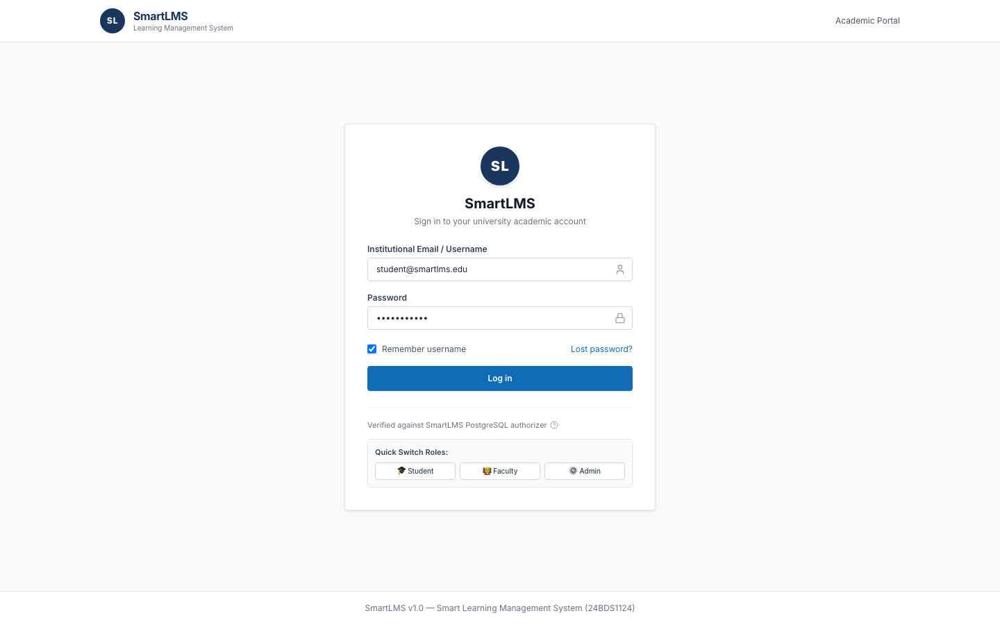
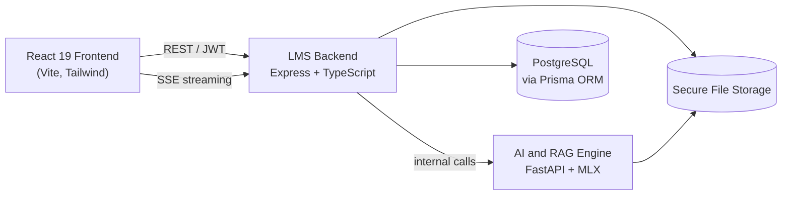

# SmartLMS — AI-Assisted Learning Management System

> **Software Engineering Project** · Abhinav Kumar Singh (`24BDS1124`) · Fall Semester 2026-27
>
> 🔒 **Showcase repository.** This repo presents the project's design, architecture, features, and verification results. The implementation source code is intentionally **not published** and is **All Rights Reserved** (see [LICENSE](LICENSE)).



---

## Overview

SmartLMS is an academic Learning Management System with a built-in, **on-device AI tutor and assessment assistant**. It combines a classic LMS (courses, assignments, grading) with a dual Retrieval-Augmented Generation (RAG) engine, while keeping the faculty in control: the AI only *advises*, and a grade becomes official only after a faculty member publishes it.

### Highlights

| Area | What it delivers |
| :--- | :--- |
| **Role-based access** | Separate `STUDENT`, `FACULTY` and `ADMIN` experiences enforced on both the UI and the API |
| **Dual RAG** | *Workflow A* answers course questions from public material. *Workflow B* evaluates submissions against confidential faculty answer keys, isolated from students |
| **Local AI** | Runs open-weight LLMs and embedding models on Apple Silicon, so no student data leaves the machine |
| **Role-aware tutor** | Students get Socratic, step-by-step guidance. Faculty get unrestricted technical and pedagogical help |
| **Assessment pipeline** | Submission → AI evaluation against a rubric with evidence citations → faculty review → official grade |
| **Safety** | Answer-key protection, prompt-injection defence, and non-penalisation of valid alternative solutions |

---

## Architecture



| Tier | Technology | Responsibility |
| :--- | :--- | :--- |
| Frontend | React 19, TypeScript, Vite, Tailwind CSS, React Router, Recharts | Dashboards, course pages, AI tutor workspace, faculty review queue |
| LMS backend | Node.js, Express, TypeScript, Prisma, JWT, Multer | Auth, RBAC, courses, assignments, submissions, authoritative gradebook |
| AI service | Python, FastAPI, Apple MLX, Qwen2.5 (4-bit), BGE-small embeddings, PyMuPDF | Document ingestion, dual RAG, rubric-based evaluation, streaming chat |
| Data | PostgreSQL | Users, courses, assessments, grades |

More detail: [Architecture](docs/ARCHITECTURE.md) · [Data model](docs/DATA_MODEL.md) · [Assessment workflow](docs/WORKFLOW.md)

---

## Feature Tour

- **Student:** dashboard and calendar, course catalogue and detail pages, assignment download and submission, published grades, progress and certificates, announcements, collaboration, and the Eno AI Tutor.
- **Faculty:** course and module management, assignment creation with rubrics, confidential answer-key upload, AI-assisted review queue, mark adjustment, and official grade publication.
- **Admin:** institution-wide course and user management panel.
- **Eno AI Tutor:** streaming chat with role-aware behaviour, grounded in the course's own material.

---

## Engineering Practices

- **Layered backend** with controllers, routes, middleware, and a typed service client for the AI engine.
- **Authoritative-backend principle:** the AI service is advisory and the LMS backend is the single source of truth for grades.
- **Security by design:** JWT sessions, role guards, server-side stripping of confidential data, upload type and size limits, and prompt-injection screening.
- **Automated verification:** an integration suite covering data integrity, RBAC, the full assessment pipeline, and AI/RAG behaviour (38 checks across the backend and AI stages).
- **One-command orchestration:** a launcher script starts the three services, monitors their health, and shuts them down cleanly.

---

## Verification Summary

| Suite | Scope | Result |
| :--- | :--- | :--- |
| Backend verification | Accounts, courses, rubrics, submissions, grading, quizzes | ✅ 24 / 24 |
| Advanced AI pipeline | Role-aware AI, dual-RAG isolation, auto-assessment, faculty publish | ✅ 14 / 14 |

---

## Repository Contents

```
SmartLMS (showcase)
├── README.md            ← you are here
├── LICENSE              ← proprietary, view-only
└── docs/
    ├── ARCHITECTURE.md  ← system design and security model
    ├── DATA_MODEL.md    ← entity-level data model
    ├── WORKFLOW.md      ← assessment and review workflow
    └── screenshots/     ← UI captures
```

---

## Source Code Access

The full source is kept private. Academic evaluators and recruiters can request a **live demo or read-only code walkthrough** by contacting the author via GitHub [@abhinavkumars1ngh](https://github.com/abhinavkumars1ngh).

© 2026 Abhinav Kumar Singh. All Rights Reserved. Copying this work or submitting it as your own is prohibited.
