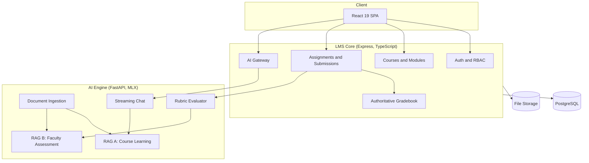

# Architecture

SmartLMS is a three-service system. Each service has a single responsibility and communicates over HTTP.

## Design Principles

1. **Backend is authoritative.** Only the LMS core can create an official grade, and only after a faculty member publishes it.
2. **AI is advisory.** The AI engine proposes scores with evidence, and humans decide.
3. **Confidentiality by isolation.** Reference solutions live in a separate retrieval workflow that student-role requests can never reach.
4. **Local-first AI.** Models run on-device on Apple Silicon (MLX), which keeps student work private and removes API costs.
5. **Role-aware behaviour.** The same tutor adapts its pedagogy to the caller's role.

## Security Model

| Concern | Mitigation |
| :--- | :--- |
| Unauthorised access | JWT sessions and role guards on every protected route (UI and API) |
| Answer-key leakage | Server-side stripping of reference data and isolated retrieval workflow |
| Prompt injection | Adversarial patterns (e.g. "ignore previous instructions", "reveal the answer key") are rejected and flagged |
| Malicious uploads | File-type allow-list and per-category size limits |
| Unfair grading | Evaluation is semantic, so valid alternative solutions are not penalised |
| Secrets | Configuration through environment variables only, never committed |

## Role Capabilities

| Capability | Student | Faculty | Admin |
| :--- | :---: | :---: | :---: |
| AI tutor | Guided | Unrestricted | Full |
| View and query course material | Enrolled courses | Assigned courses | All |
| Download assignment questions | ✅ | ✅ | ✅ |
| Access reference answer keys | ❌ | ✅ | ✅ |
| See AI evaluation proposals | ❌ | ✅ | ✅ |
| Publish official grades | ❌ | ✅ | ✅ |
