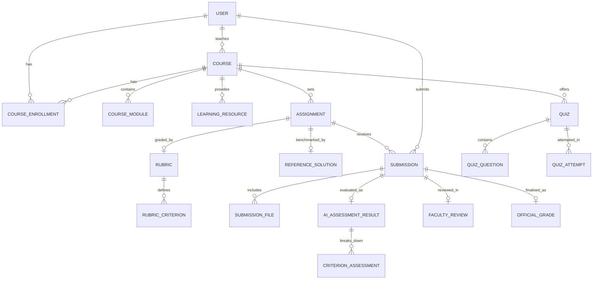

# Data Model (Entity Level)

A high-level view of the relational model (PostgreSQL). Field-level detail is intentionally omitted.

| Group | Entities |
| :--- | :--- |
| Identity | User (Student / Faculty / Admin) |
| Learning content | Course, Enrollment, Module, Learning Resource |
| Assessment setup | Assignment, Rubric, Rubric Criterion, Reference Solution, Quiz, Quiz Question |
| Student work | Submission, Submission File, Quiz Attempt |
| Evaluation | AI Assessment Result, Criterion Assessment, Faculty Review |
| Records | Official Grade |
