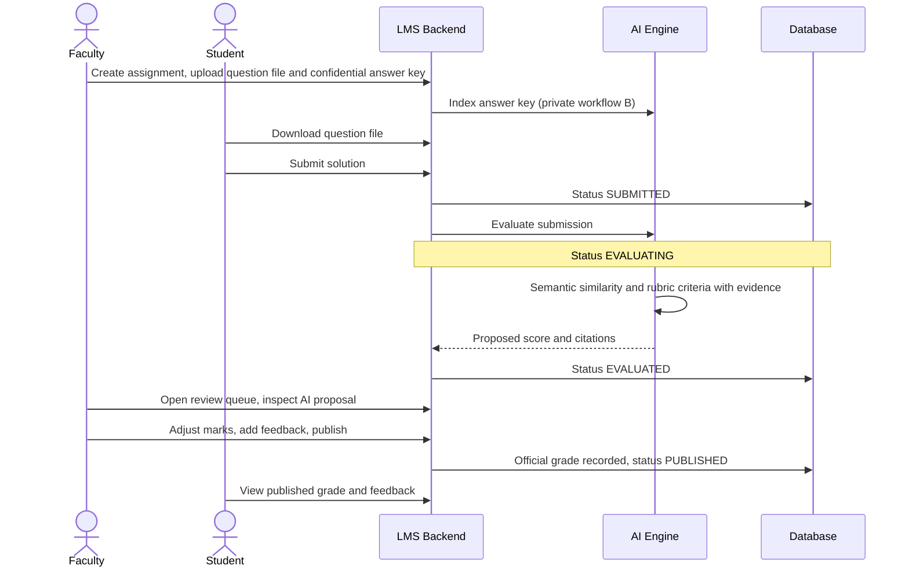

# Assessment & Faculty Review Workflow

## Status Lifecycle

`SUBMITTED` → `EVALUATING` → `EVALUATED` → `PUBLISHED`

## Key Guarantees

- Students never see the AI's raw proposal or the reference solution.
- An official grade exists **only** after explicit faculty publication.
- Evaluation recognises equivalent solutions, such as recursion versus iteration or vectorised versus looped code.
- Every rubric criterion in the AI proposal carries supporting evidence from the submission.
